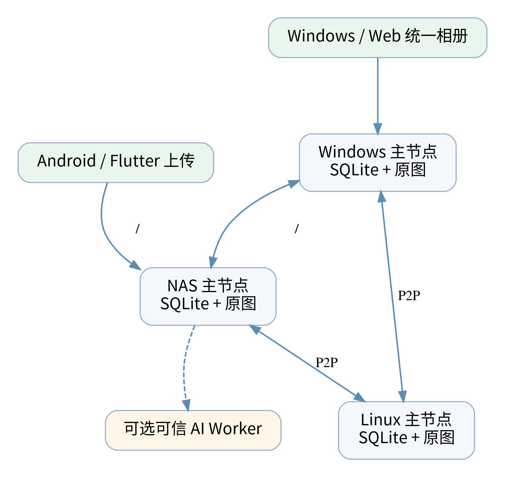
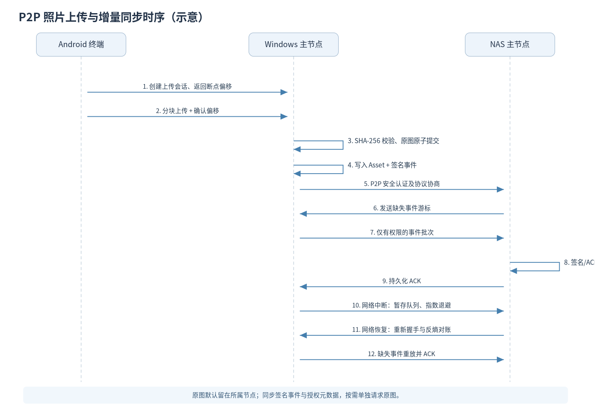
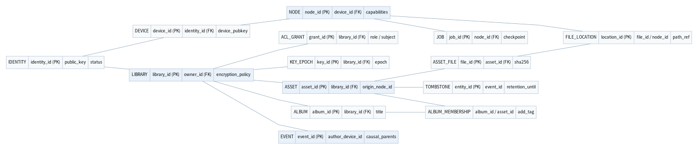

## 文档目录

1. 完整产品需求与 30 题追溯
2. 技术架构与分布式同步设计
3. 开发路线图与任务清单
4. 测试与验收标准
5. 架构决策与风险
6. Monorepo 目录规划
7. Codex AGENTS.md 开发准则
8. Codex 分阶段提示词
9. 统一任务模板
10. 架构图与官方资料


> **状态：设计初稿（待架构/安全评审），非已完成的软件项目。** 基于用户已确认的 30 题需求。首发优先 Windows、Android、NAS；P2P 必须首版；AI 第二阶段。


# 一、产品需求（PRD）

## PhotoMesh 产品需求文档（PRD）

- 状态：初稿（待技术评审）
- 版本：PRD 1.0-draft
- 用户访谈依据：已完成 30 题需求确认；不把“希望最终支持”混同于“首版已实现”
- 许可证：Apache License 2.0（对所选第三方依赖和模型分别执行许可审查）

### 1. 产品愿景

一个 **自托管、跨平台、去中心化、可扩展、原图无损** 的相册系统。允许 Windows、Linux 和 NAS 等多台主存储节点分别保存原图，在没有强制公网服务器的条件下，通过可信设备配对与 P2P 元数据同步，向 Windows、Android、iOS、macOS、Linux 和 Web 客户端展示统一相册。既能像照片备份工具一样自动上传，也能像专业照片管理器一样管理文件夹、标签、RAW、视频和 AI 索引。

**核心价值排序：** ① 原图安全 ② 自动备份可恢复 ③ 多节点可用和统一体验 ④ 跨平台易用 ⑤ 开放插件和 AI 扩展。

#### 1.1 目标用户与主要场景

| 用户 | 任务 | 核心价值 |
| --- | --- | --- |
| 个人用户 | Android 在 Wi-Fi 下备份到 NAS、外出浏览照片 | 省心、安全、离线可看 |
| 自托管用户 | Windows + NAS 两主节点独立保管文件并统一呈现 | 无强制第三方服务和全量复制 |
| 家庭用户 | 私有相册、家庭共享、访客限时链接 | 授权清晰、不泄露隐私 |
| 摄影者 | 索引 NTFS/ext4/Btrfs 既有图库、RAW+JPEG、XMP | 原图不可变、路径仍可管理 |
| 开发者 | Python/JavaScript 插件、OpenAPI、MCP、Webhooks | 可扩展的工作流与 AI |

### 2. 30 项已确认需求追溯

| 编号 | 类别 | 已确认需求 | 首版处理 |
| --- | --- | --- | --- |
| Q01 | 同步模式 | 双向同步与主设备集中存储可配置 | P0：备份模式与元数据双向；完整跨端副本管理后续扩展 |
| Q02 | 平台 | Windows、Android、Linux、Web、NAS、iOS、macOS | Windows/Android/NAS 优先；Linux 主节点、Web 随基础架构上线；其余后续 |
| Q03 | 主节点 | Windows/NAS/Linux 可作多个主节点 | P0 |
| Q04 | 主节点关系 | 各节点独立存原图，统一索引与浏览 | P0 |
| Q05 | 上传 | 全自动/仅 Wi-Fi/手动，逐设备配置 | P0：Android Wi-Fi/手动；其他模式渐进 |
| Q06 | 目标分配 | 默认绑定、手动选择、智能选择、自定义规则 | P0：绑定与手动；智能策略后续 |
| Q07 | 网络 | LAN 直连、手动远程、自动 P2P、可选中继 | P0：LAN P2P；远程自动打洞/中继迭代 |
| Q08 | 离线 | 缩略图缓存、原图下载、上传队列、断点续传、离线操作及补同步 | P0：缓存/队列/断点续传；离线编辑演进 |
| Q09 | 删除 | 本地/全局范围可设、回收站、保留期限和恢复 | P0：范围区分与回收站，永久删除审批 |
| Q10 | 冲突 | 字段智能合并、冲突提醒、版本历史及恢复 | P0：基础并发事件/冲突；复杂合并迭代 |
| Q11 | 管理 | 时间线、真实目录、虚拟相册、标签、收藏评分、地图、搜索、批量、全屏、隐藏/密码相册、RAW/HEIC/Live Photo、去重、文件夹成册 | 时间线/扫描/虚拟相册/筛选 P0；其余分阶段 |
| Q12 | AI 功能 | 人脸、物体场景、语义搜索、相似图、OCR、质量分析、分类、视频、描述、AI 助手；自定义模型、GPU、宠物、重识别、回忆视频 | P1+，首版不阻塞 |
| Q13 | AI 位置 | 主节点、终端、独立 GPU、可选云 API 任务级可配 | P1+ |
| Q14 | 身份权限 | 单/多用户、家庭共享、角色、访客、限时分享、设备授权、本地/OAuth/2FA、配额、密码相册、E2EE | P0 基础本地身份与权限；细粒度/共享/E2EE P1+ |
| Q15 | 备份加密 | 普通相册可选加密、独立密钥、E2EE、自动增量、S3/WebDAV/NAS、硬件密钥、离线备份、灾备和定期恢复演练 | P0 传输保护、可验证备份原型；完整体系 P1+ |
| Q16 | UI | 手机时间线，桌面高级管理；深浅模式、主题、毛玻璃、侧栏、网格、通知、托盘、手势 | P0 自适应骨架，视觉增强迭代 |
| Q17 | 技术 | Tauri 2+Vue 3 桌面、Flutter 移动、Vue 3 Web、Node.js 优先、Windows 开发、GitHub Actions、SemVer、非破坏性更新 | P0 基础工程 |
| Q18 | 后端 | 完全去中心化 P2P；无强制公网服务；SQLite/PostgreSQL 可选；Docker Compose；避免 Redis；自动发现与热插拔 | P0 两节点 P2P + SQLite；PG 适配增量 |
| Q19 | 原图 | 外部文件夹/托管/内容寻址混合，每节点可配；原图永不修改、外部变化检测、符号链接、NTFS/ext4/Btrfs/S3、去重保留路径 | P0 只读扫描/托管/哈希；S3 等后续 |
| Q20 | 媒体 | 完整图片视频引擎、RAW/HEIC/AVIF/HDR/LivePhoto、4K/8K/HDR10/DolbyVision、RAW+JPEG/XMP、FFmpeg、GPU、转码与流播；模块开关默认开启 | P0 基础预览；高级媒体引擎 P1+，原图不可变始终强制 |
| Q21 | 交付 | 安装/便携/Docker/源码、自动或手动更新、灰度、升级备份、回滚、迁移、多节点协调 | P0 可部署安装+迁移；自动灰度后续 |
| Q22 | 性能 | 2GB NAS 可运行，无 GPU，ARM64/x64，AI 可关闭，10 万快速搜，百万级索引，低内存/低 CPU | 全程约束；百万级长期目标 |
| Q23 | 开源 | Apache License 2.0 | P0 |
| Q24 | MVP | Windows+Android+NAS 最优先；Linux 主节点、Web 客户端；P2P 必须首版；照片自动备份优先；AI 第二阶段；首日起测试和 CI | P0 |
| Q25 | 工程 | 单测覆盖率 >80%，模块完成必测，所有 PR 过 CI；Monorepo、pnpm+Turborepo、Vitest、Playwright、Flutter test、Docker 集成测试、OpenAPI | P0 |
| Q26 | 生态 | REST/OpenAPI/SDK/MCP、Python/JavaScript 插件、插件商店/本地/热更新、工作流/Webhook、扩展权限、第三方 AI | OpenAPI 基础 P0；MCP 插件生态 P1+ |
| Q27 | i18n | 简中/英文首发，繁中及社区语言；无障碍、字体/界面缩放、RTL 预留、时间日期本地化、热切换、不硬编码、多语言安装器 | P0 简中/英文与框架 |
| Q28 | 验收 | 分级性能/安全/可靠性；10万索引搜索 P95<1秒；2GB NAS 内存预算待细化；每次发布10万文件同步；网络恢复后60秒内重新同步；全文件 SHA-256 | 验收硬门槛按版本分级 |
| Q29 | 治理 | Stable/Beta/Nightly、LTS、安全私密报告、公开 Roadmap、Changelog、Discussion、Issue/PR 模板、至少相邻次版本协议兼容、安全降级 | P0 基本流程，LTS 后续 |
| Q30 | Codex | 阶段化多 Agent、AGENTS.md/Skills、Worktree、依赖管理、自动提交、审查、CI、文档和发布，高风险动作需人工审批；ER/P2P 时序图、中文报告及提示词 | P0 |

**注：** P0=首发 MVP 必须具备的核心能力；P1=首发后优先；P2=高级/扩展。没有列入 P0 不等于删除需求。

### 3. 核心使用流程及验收

#### 3.1 Android 首次自动备份

1. 用户在 Windows 或 NAS 安装主节点服务，创建第一个本地管理员身份。
2. 通过二维码/短期配对码将 Android 客户端纳入信任关系；设备凭据留存在系统安全存储。
3. 配置相册来源、目标主节点、Wi-Fi/移动数据/仅充电等策略。
4. Android 枚举权限范围内的新照片，记录任务；使用分块传输、暂停恢复、重试和哈希校验。
5. 服务端原图落盘采用临时文件+完整性校验+原子提交，不就地改写已有文件。
6. 上传完成生成缩略图/元数据；其他已授权节点逐步获得事件，并统一展示。

**AC-MVP-01：** 断网、杀进程和节点重启不得造成已确认的成功上传文件损坏；重新连接后继续未完成部分。手机后台任务受 Android/iOS 系统调度限制，不能保证精确实时。

#### 3.2 多主节点统一浏览

Windows 节点有 A/B，NAS 有 C/D：设备在得到授权后通过 P2P 事件发现 A/B/C/D 的元数据和可用性；时间线可合并四张照片。NAS 离线时缓存缩略图仍可展示 C/D，尚未下载的原图明确标记为不可用，而不是伪造可访问状态。

**AC-MVP-02：** 节点添加、离线、重新上线时，照片不会出现无来源的重复元数据；无权限用户不得获取受保护的索引。

#### 3.3 删除和回收站

“释放本机空间”只作用于本机副本；“从共享照片库移除”生成签名墓碑事件；“永久销毁”经过授权与风险确认，并遵守保留和备份策略。离线旧节点重新加入时不得把已删除对象误当新对象复活。

#### 3.4 编辑与版本

原图永久不可变。修改收藏、标签、相册关系通过事件同步；同一字段并发修改可出现待处理冲突。图片编辑产生新版本文件，不覆盖原始字节；历史版本按权限保留与恢复。

### 4. 版本范围（不能一次性交付全部愿景）

| 优先级 | 核心能力 | 目标用户可见结果 |
| --- | --- | --- |
| P0 首发 | Windows/NAS/Linux 主节点、Windows/Android/Web、两主节点 P2P、LAN 配对、自动备份、只读索引、时间线、基础权限、缓存队列、原图哈希、回收站、日志与测试 | 可自部署、不依赖中心服务器、能安全地自动备份并统一浏览 |
| P1 | 互联网 P2P 优化、转发可选、跨设备元数据合并、多用户共享、硬件密钥、E2EE、S3/WebDAV备份、首批 AI（OCR/场景/人脸可选） | 更成熟的远程体验、安全协作和 AI 整理 |
| P2 | iOS/macOS 客户端完善、全媒体引擎、分布式 AI、MCP/插件市场、工作流、百万级优化、长周期 LTS | 专业级生态和大规模照片库 |

**MVP 定义：** “第一版必须有 P2P”具体定义为“两台已配对 Windows/NAS/Linux 主节点在可达局域网中直接同步**有权限的元数据及事件**，并提供按需原图传输”。不把全球任意 NAT 场景无中继互通作为首发阻塞条件。

### 5. 功能性需求与优先级（摘取实现核心）

| ID | 功能 | 优先级 | 验收 |
| --- | --- | --- | --- |
| FR-001 | 原图不可变导入 | P0 | 导入前后 SHA-256 一致，不写入外部只读源 |
| FR-002 | 多节点可信配对 | P0 | 未授权节点无法读取索引；重复配对幂等 |
| FR-003 | P2P 增量事件传播 | P0 | 断线补偿、重复事件幂等、落后节点重放 |
| FR-004 | Android 自动备份 | P0 | 用户可配置 Wi-Fi/手动，队列恢复可靠 |
| FR-005 | 跨节点统一相册 | P0 | 按权限合并时间线并显示来源/离线状态 |
| FR-006 | 基础权限、范围删除 | P0 | 本地清理不触发全局删除；回收站可恢复 |
| FR-007 | 只读扫描现有目录 | P0 | 大量文件增量扫描和外部变化重建索引 |
| FR-008 | i18n | P0 | 简中/英文无硬编码，切换即时生效 |
| FR-009 | 完整历史与冲突提示 | P1 | 同字段并发冲突显式呈现，版本可恢复 |
| FR-010 | 用户共享与 E2EE | P1 | 密钥只交给授权主体；退出共享需考虑重加密 |
| FR-011 | AI 识别与任务调度 | P1 | 可关闭/可退化至 CPU，不阻塞备份 |
| FR-012 | 开放 MCP/插件运行时 | P2 | 最小授权，删除等危险操作二次确认 |

### 6. 产品与设计原则

- **默认安全：** 原图不可变，默认不自动执行永久删除；备份与同步分离。
- **离线优先：** 显示离线标识、延迟提交和可重试队列；不能将本地缓存当作永久备份。
- **透明存储：** 可以定位原图所在节点/路径，保留来源、文件名、拍摄信息；统一相册不强制改写物理目录。
- **可控资源：** 2GB NAS 默认禁用繁重媒体任务，可独立关闭 AI/转码；功能“默认开启”的偏好在硬件不足时应以安全阈值、明确提示和智能降级为前提。
- **用户隐私：** EXIF GPS、人物嵌入向量、OCR 内容属敏感索引，受授权控制。公开分享应默认去除不必要的隐私元数据。
- **开放但不放权：** API、MCP、插件无法绕过核心访问控制。

### 7. 非功能与可访问性要求

- 无强制中心服务器、私有部署、容器与 Windows 便携安装；支持 ARM64/x64。
- 10万照片预索引搜索 P95<1s；长远百万级；精确样本与硬件由测试计划定义。
- 分布式数据同步满足最终一致性，不承诺网络分区期间强一致、同步读取所有离线原图。
- 所有原始字节传输均按 SHA-256 复核；日志不得包含私密原图或密钥。
- WAI-ARIA 等价无障碍实践、键盘控制、屏幕阅读器、字体与触控目标、RTL 预留、日期/时区/数字本地化。

### 8. 尚待正式评审的决定

1. **信任根与设备身份恢复**：推荐本地用户主密钥 + 新设备扫描邀请 + 可选离线恢复包，恢复包丢失可能无法恢复 E2EE 内容。
2. **复杂多用户权限冲突**：推荐以相册所有者签名的 ACL 事件为权威，不允许普通成员离线改写管理员策略。
3. **AI 与 E2EE**：推荐在获授权的可信设备/节点解密，不将密文伪称可以直接被云端模型识别。
4. **2GB NAS 内存预算和测试机配置**：首发之前据性能探针确定具体峰值指标。
5. **相邻次版本协议兼容及数据库安全降级策略**：经独立迁移测试验收。

详见 `05_ADR_未决决策与风险.md`。


\newpage


# 二、技术设计（TDD）

## PhotoMesh 技术架构设计（TDD）

- 文档状态：待设计评审；对应 PRD 1.0-draft
- 目标：首发 Windows + Android + NAS，保留 Linux 主节点/Web，以及七平台长期演进能力
- 约束：完全去中心化、不依赖强制公网中心服务；Node.js 优先；原图不可变；多主节点独立存储；开源 Apache-2.0

### 1. 逻辑架构及部署单元

```
Android/Flutter ──┐        ┌── Windows node-agent(Node.js+SQLite+blob store)
Windows/Tauri ────┼─ P2P ──┤
Web/Vue (本地已授权节点代理访问) ──┤        └── NAS/Linux node-agent(Node.js+SQLite+blob store)
                       │
                   [可选用户自建 VPN / relay / STUN / TURN]
                       │
                   [未来：可信 AI worker / 插件 worker / PG 适配]
```

**区分三类组件：**

1. **主存储节点 `node-agent`**：索引扫描、元数据持久化、对象写入、上传下载、P2P 事件收发、策略校验、缩略图队列、备份日志；在 Windows/NAS/Linux 本地运行。
2. **客户端 `desktop` / `mobile` / `web`**：统一时间线、缓存、配置、离线任务队列、设备配对；Android 使用系统照片访问权限与后台任务调度；Web 使用受信任本地节点作网关，不把浏览器当作万能后台守护进程。
3. **可选扩展 `ai-worker` / `plugin-host` / relay**：独立进程、受限权限和任务配额，**不属于核心服务必选依赖**。

**多主节点一致性边界：** 最终一致性元数据 + 独立原图所属节点。离线时可以读取缓存但不保证随时取得原图。不要使用中心数据库“单写主”的设计破坏完全去中心化需求。

### 2. 建议技术栈与理由

| 层 | 建议 | 决策理由与边界 |
| --- | --- | --- |
| Node 运行时 | 支持期内的 Node.js LTS + TypeScript strict | 用户指定 Node 优先；兼容 ARM64/x64；固定可重复构建版本，不写死过期版本号 |
| 服务端框架 | Fastify（候选）+ Zod/TypeBox + OpenAPI | 较小依赖规模、可生成接口契约；启动与内存需基准测试 |
| P2P | 独立 `transport` 接口，LAN mDNS+安全直连优先；libp2p/WebRTC 为候选 | 能在不依赖公网的 LAN 验证首发要求；互联网 NAT 穿透选件 |
| 增量事件 | SQLite 事务事件日志、outbox/inbox、每设备游标、可重放投递 | 可恢复、可审计、幂等、故障测试容易实现 |
| DB | SQLite（默认，WAL+FTS5）；PostgreSQL 可选 Repository Adapter | 2GB NAS 优先；PG 用于性能更高部署，不要求每节点 PG |
| 文件存储 | 本地普通目录、托管对象库与只读外部目录，S3 可选适配 | 原图不可变、保留文件来源、灵活备份；不能默默改写原图 |
| 桌面 | Tauri 2 + Vue 3 + TypeScript | 桌面系统集成及代码复用；按平台签名发布 |
| 移动 | Flutter / Dart + 原生后台备份桥接 | Android/iOS 系统能力需单独适配；可共用 OpenAPI 协议和数据规范 |
| Web | Vue 3 +共享组件 | 浏览器通过受信任节点的 HTTPS API 获取数据 |
| 媒体 | libvips/sharp、FFmpeg/ffprobe 等可选适配 | 尺寸缓存、预览、流式播放；专业格式受平台解码器/许可限制 |
| AI | 可选 worker：ONNX Runtime 等经审核的模型推理适配 | CPU 可用、GPU 可选、模型管理独立、禁用后核心服务仍可运行 |
| 构建 | pnpm workspace + Turborepo；Flutter 独立 pub 管理 | JS/TS 任务统一；Flutter 使用脚本编排，不伪称由 pnpm 直接托管 Dart |
| 质量 | Vitest、Playwright、Flutter test、Docker 多节点集成 | 用户已定量化门槛，性能报告保留测试环境元信息 |

备选技术必须经过 ADR、依赖许可证审查、负载基准与 Windows/ARM64 适配验证才能定型。

### 3. 数据模型：身份、节点、照片、事件

详细 ER 图：`../diagrams/ER_元数据模型.mmd`。

#### 3.1 核心实体定义

| 实体 | 关键字段 | 含义 |
| --- | --- | --- |
| `identities` | identity_id、public_key、created_at、status | 本地用户身份公钥标识；私钥不入数据库明文 |
| `devices` | device_id、owner_identity_id、device_pubkey、trust_state、last_seen | 已配对设备；可撤销且可跟踪可信状态 |
| `nodes` | node_id、device_id、endpoint_hints、capabilities、state | 主节点，动态能力宣告，不含必须公网地址 |
| `libraries` | library_id、owner_id、name、acl_epoch、encryption_policy | 相册库逻辑安全边界与权限版本 |
| `assets` | asset_id、library_id、origin_node_id、capture_ts、mime、kind、deleted_at | 逻辑照片记录；不是磁盘路径或文件名 |
| `asset_files` | file_id、asset_id、sha256、byte_size、media_role、storage_ref | 主图、RAW/JPEG伴侣、Live Photo 视频、衍生文件；受授权访问 |
| `file_locations` | location_id、file_id、node_id、path_ref、storage_class、availability | 物理节点及可访问位置；保留不同原始路径/文件名 |
| `albums` | album_id、library_id、type、rule_query、title | 虚拟相册、按文件夹生成相册、智能相册 |
| `album_memberships` | album_id、asset_id、add_tag、removed_by | OR-Set 风格并发成员变更 |
| `asset_tags` | asset_id、tag、add_tag、removed_by | 可合并标签事件 |
| `acl_grants` | library_id、subject_id、role、scope、epoch、signature | 由所有者或授权管理员签名的权限事件 |
| `keys` | key_id、scope_id、key_epoch、wrapped_material_ref | 密钥封装引用，绝不明文保存用户主密钥 |
| `events` | event_id、author_device_id、seq、causal_parents、payload_hash、signature | 持久事件；验证后落入 inbox 并按顺序应用 |
| `sync_peers` | peer_id、last_ack_cursor、last_anti_entropy_at | 远端游标与补偿扫描 |
| `tombstones` | entity_id、scope、deleted_at、retention_until、event_id | 防止离线旧节点重新引入已删除文件 |
| `jobs` | job_id、type、state、attempts、lease_until、checkpoint | 上传、预览、AI、备份与恢复任务 |
| `audit_logs` | actor、action、resource、outcome、request_id、created_at | 高风险操作留痕，避免泄露私密内容 |

**关系关键点：** `assets`→多个 `asset_files`；每份文件→多个 `file_locations`；`albums` 与 `assets` 多对多。不要以文件哈希作为“照片 ID”，因为重复照片可有多个逻辑来源和路径。

#### 3.2 ID、哈希和索引

- 使用 UUIDv7 或 ULID 作为逻辑 ID（评估跨平台可用性），全局唯一且不泄露真实路径。
- 文件原字节采用流式 SHA-256；传输块另有块校验或认证标签。服务端完整内容复核后再提交成功。
- E2EE 数据去重**不能**直接以跨用户公开哈希暴露相同内容关系。按安全域使用受密钥约束的映射/去重，不强制跨用户共享对象。
- 日期索引基于拍摄时间、时间偏移和来源可信度；UI 根据用户时区展示。相同文件的不同路径需独立保存。
- SQLite 为每库预建复合索引 `(library_id,capture_ts,asset_id)`；FTS5 处理授权范围内的非加密明文元数据；向量搜索是后续独立插件或 worker。
- SQLite 适配层需提供读事务、一致分页、游标式同步以及 schema migration；PostgreSQL 使用同一 Repository 契约 + 差异化 SQL。

#### 3.3 PostgreSQL 可切换的真实含义

支持**新建部署选择** SQLite 或 PG、提供明确的导出/迁移工具；不承诺运行中一键切换，更不能让两种数据库共享同一 SQLite WAL 文件。迁移步骤：只读维护窗口→快照→导出→校验行数及哈希→切换→健康检查→回滚点保留。

### 4. P2P 信任、发现与连接

#### 4.1 身份模型（建议 ADR-001）

- 每个设备在本地生成持久密钥对（首版优先 Ed25519 签名身份；会话安全通道使用经过审计的 TLS/Noise 等成熟方案）。私钥保存于 OS Keychain/Android Keystore 等受保护存储或加密密钥文件，不传入同步事件。
- 首台设备建立用户身份与主设备信任根；新增设备通过二维码/短期邀请完成**带密钥指纹确认**的双向配对，防御替换/中间人攻击。
- 节点之间强制双向身份认证，配对令牌单次使用且短有效期，撤销后禁发后续新数据。
- 本地账号是默认；OAuth/OIDC 属可选身份联合，不使一个公有 IdP 成为 LAN 离线使用的强制依赖。
- 身份/恢复私钥离线加密备份；遗失密钥时不保证 E2EE 数据一定可恢复，应在产品中清晰告知。

#### 4.2 发现与网络路径

- LAN：mDNS/手动 IP/二维码地址，防止仅凭广播名就信任设备。
- 互联网：已授权端点缓存/手动域名/用户自建 VPN；未来加入 ICE/STUN；不通时可以用户自建 TURN/转发服务。
- 必须支持**完全无公网服务器**在同一可达 LAN 中工作；无法保证两端在对称 NAT/CGNAT 下必然 P2P 直连。
- 浏览器 Web 客户端由用户信任的 `node-agent` 提供 HTTPS API；浏览器本身不应强制运行全套文件守护任务。
- 防范节点热插拔：`node_id` 不依赖 IP；活性检查、退避重连、能力变更事件；主节点离线不会导致已缓存目录删除。

#### 4.3 P2P 协议（初版建议）

握手：`Hello(protocol_min,max,capabilities,node_id,nonce)` → 认证挑战/签名 → 取双方已知事件游标 → `GetEventsSince`/Merkle 范围对账 → 校验签名和 ACL → 持久 inbox → 幂等应用 → 发送 ACK。

```
EventEnvelope {
  eventId, authorDeviceId, authorSequence, libraryId,
  type, payloadCiphertextOrData, keyEpoch, causalParents[],
  createdAtHint, schemaVersion, signature
}
```

- **幂等**：`event_id` 唯一约束。收到重复事件只 ACK，不重复改变业务状态。
- **顺序**：每作者 `authorSequence` 单调递增；跨作者因果使用版本向量摘要或父事件引用，不能把客户端墙上时钟当可靠因果顺序。
- **传输**：TLS/mTLS 或审计过的 Noise；所有权限/签名校验在服务端进行，不能仅依赖客户端隐藏按钮。
- **补偿**：`lastAckCursor` + 事件范围对账，较长离线节点必须能重放；保留 tombstone 直到所有有资格节点确认或执行明确的过期设备撤销程序。
- **对象传输**：按 `assetId/fileId` 授权请求；分块范围下载、临时路径、块校验、最终 SHA-256、原子落盘。
- **权限**：订阅事件前授权过滤，不能把整个明文索引广播给所有已配对但无权限节点。
- **删除**：使用墓碑和回收站；永久删除需要权限验证及保留策略；离线节点重联要抑制旧事件“复活”。

#### 4.4 冲突合并规则

| 变更 | 建议策略 |
| --- | --- |
| 标签、虚拟相册成员 | 带操作 ID 的 OR-Set/可合并事件 |
| 收藏、评分 | 每用户独立记录或检测并发并提示，禁止静默覆盖 |
| 物理文件路径 | 由拥有该位置的原图节点单写，其他节点只接收其签名更新 |
| 图片编辑 | 衍生版本，原图不可改，显示版本分支 |
| ACL、成员撤销 | 以所有者/授权管理员签名事件为权威，冲突拒绝越权操作 |
| 全局删除 | 仅有权主体签发墓碑，冲突按删除保护与恢复流程处理 |

**一致性声明：** 这是“授权范围内最终一致的元数据”，不承诺跨网络分区的线性一致、离线时永久有效的权限撤销、即时撤回已缓存明文。

### 5. 存储层与媒体管线

#### 5.1 原图不可变落盘

1. 上传临时对象（权限、剩余容量和限流检查），为每份文件记录来源、原始文件名和相对路径。
2. 流式写入 `staging/<id>.part`；块校验、断点、完整 SHA-256。
3. 校验后提交到 `managed/objects/...`，采用适合文件系统的 `fsync/rename` 原子可见策略；跨卷场景必须复制后再校验。
4. 记录 `asset_file` 和 `file_location`；缩略图、转码、AI 为独立派生任务，不影响写入成功。
5. 同样内容的原图可在同一安全域由对象层复用，但数据库保留每个原始路径、名字、来源和逻辑相册条目。

#### 5.2 外部目录、符号链接和扫描

- 外部文件夹默认 **只读**，使用 file watcher 加定期全量/增量巡检，监听事件丢失时可以完整修复索引。
- 符号链接默认不跟随到授权根目录外；允许显式白名单根，检测环路和权限切换，防止敏感目录泄露及路径穿越。
- NTFS/ext4/Btrfs 各自具有大小写、权限、inode、时区和符号链接差异；任何路径键都需标准化并记录原始展示名。
- 对外部原图改变：创建新的内容版本/重新索引，**不回写覆盖源文件**；对外部物理删除：标记丢失/待确认，避免直接触发全局相册删除。
- S3 是可选存储后端，凭据与区域必须由用户配置，注意对象版本控制/费用/一致性与 E2EE 授权。

#### 5.3 图片/视频处理与格式

| 类型 | 行为 |
| --- | --- |
| RAW+JPEG、HEIC、AVIF、WebP | 原图存储、格式检测、嵌入预览提取，生成独立缩略图；RAW+JPEG 逻辑关联 |
| Live Photo/Android 动态照片 | 保留图片和视频配对文件，关系由 `asset_files.media_role` 描述 |
| XMP Sidecar | 作为关联媒体处理；外部源默认只读，派生 XMP 不覆盖源文件 |
| 4K/8K、HDR10/Dolby Vision | 尽可能原样保存，客户端不支持则按权限/许可生成 SDR/兼容预览；标示保真级别 |
| 视频 | 封面提取、范围流式播放、可选 HLS/分段播放，按设备支持转码 |
| FFmpeg/GPU | 可选独立 worker，探测硬件编解码器/驱动后启用；失败回退 CPU 或直接提供原文件下载 |

用户请求可手动启闭相关媒体处理功能，**默认开启不应导致 2GB NAS 被高负载任务拖垮**：硬件不支持或缺少授权 codec 时显示“未生效/已降级”，默认并发=低优先级上限。原图不可变属于强制数据安全规则，不能关闭。

### 6. E2EE、ACL、回收站及备份

#### 6.1 权限与加密边界

- 普通相册可选 E2EE；密码相册拥有独立内容密钥及用户配置独立解锁因素（不可简单把“密码”当唯一恢复手段）。
- 每个共享库维护 **密钥 epoch**，密钥材料通过接收设备公钥封装；ACL 更新需授权签名。
- 同步索引只分享所需字段；加密库的缩略图/OCR/嵌入向量也应同等保护，不把敏感侧信道留在公开数据库。
- 若授权 AI 工作者需要明文，必须明确授予可信运行主体解密权限、日志审计及撤销机制；云端 API 请求需单独逐任务/规则授权。
- 权限撤销必须拒绝未来访问并计划密钥轮换，但无法删除其他设备此前已保存的明文副本，产品必须如实提示。
- 无法保证真正的“零知识”同时让未经授权的普通服务器任意运行明文 AI；两者不能同时宣称。

#### 6.2 删除语义

- `removeLocalReplica`：清理本设备缓存/副本，不触发 origin 删除。
- `trashAsset`：有权限的用户发签名逻辑删除事件，进入回收站并在 UI 隐藏。
- `purgeAsset`：二次确认、审批策略、过期时间验证、审计日志，持有者执行物理清理；备份副本按独立生命周期治理。
- `restoreAsset`：生成显式恢复事件并做版本冲突检查；应验证墓碑世代，避免旧节点误复活。

#### 6.3 备份与灾难恢复

- **同步不是备份**：独立做快照、增量备份、保留策略、不可变/离线副本，避免删除、勒索软件与篡改传播。
- 目标支持另一台 NAS、S3（版本化桶）、WebDAV、离线磁盘等适配；加密后上传，定期校验哈希和备份清单。
- 快照包含 DB + 事件游标 + 配置/密钥封装引用 + 原图 manifest，恢复应避免文件与元数据错位。
- 备份加密密钥与授权设备凭据分离；定期在隔离临时环境演练恢复，验证原图哈希和权限一致性。

### 7. AI、插件、MCP 的隔离架构

- `jobs` 记录任务状态，node-agent 轻量调度；2GB NAS 默认允许彻底关闭 AI、转码、视觉嵌入任务；不需要 Redis。
- worker 通过 capability、CPU/GPU/内存预算、隐私等级选择执行位置。用户能为任务指定“仅本机”“可信独立 GPU”“允许云 API”。
- 模型适配器显式标记模型许可、版本、输入要求和哈希；批量重识别不会覆盖人工标签。
- Python/JavaScript 插件默认在独立受限进程或容器运行，按能力授予文件/网络/API 访问；不能把任意代码同权限注入 Node agent。
- OpenAPI+SDK 为第一层，MCP Server 为经用户授权的受限门面。`delete/purge/share` 等高风险工具必须请求交互式批准，并记录审计。
- 插件管理支持签名、版本约束和可回滚热更新；“热更新”不得强制卸载运行中的危险任务，需等待安全点或隔离新旧进程。
- Webhook 签名/重试/去重/回放保护；定时工作流使用持久 job 队列，不默认执行 shell 或任意系统命令。

### 8. API 契约及边界

参见 `../contracts/openapi_draft.yaml`。初版 API：`/v1/health`, `/v1/identities/me`, `/v1/pairings`, `/v1/nodes`, `/v1/libraries`, `/v1/assets`, `/v1/uploads`, `/v1/sync/hello`, `/v1/sync/events`, `/v1/sync/ack`。

- **客户端 API**：经过设备令牌绑定和库级 ACL 的 HTTPS REST/OpenAPI；事件订阅用 SSE/WebSocket 可选。
- **P2P 协议**：单独受认证的 transport，不允许对公用客户端 API 直接暴露内部签名私钥或原始事件写入口。
- **API 兼容**：SemVer；在稳定版本保持相邻次版本的协议协商与数据结构可读；弃用需公告、兼容窗口和迁移工具。
- **限流与审计**：配对、登录、批量删除和公开分享设配额；对匿名访客只提供有限签名链接内容，默认无原图 EXIF/GPS。

### 9. 部署、构建与升级

- **Windows**：Tauri 安装包/便携版，`node-agent` 可作为显式安装的用户进程或服务，需考虑权限、端口/防火墙和安全卸载。
- **NAS/Linux**：Docker Compose + 非 root 镜像，挂载只读外部目录和单独可写对象目录，ARM64/x64 镜像，健康检查与持久卷。
- **Android**：Flutter 应用，前台权限/后台工作调度遵从系统政策；iOS 未来使用平台允许的后台任务和商店分发。
- **Web**：Vue SPA 由用户已授权节点托管，通过 HTTPS 或本机 loopback 访问，不依赖公共云。
- **CI/CD**：GitHub Actions 各 OS 平台构建矩阵、签名、SBOM、哈希、发布证明；Stable/Beta/Nightly 分渠道，禁止未经人工批准的生产推送。
- **升级安全**：多节点协商后分批升级；升级前 DB 快照；元数据 schema 新旧版本兼容；回滚优先恢复快照，不允许应用旧版直接读取不可逆迁移的新库。

### 10. 性能预算与可观测性

- 2GB NAS 功能基线：CPU/内存并发自适应；无 GPU 正常运行；AI 全关；媒体 worker 可移到别的节点。
- 目标数据库单库可追踪 100 万+ 资产；10 万资产已索引典型查询 P95 <1秒（严格遵循测试环境定义）。
- 发布执行 10 万文件同步集成/故障测试；网络恢复且双方可达后≤60秒自动继续；SHA-256 全文件复核。
- 节点后台空闲 CPU/内存、同步滞后、事件积压、缩略图队列、任务失败率、磁盘剩余空间可观测；默认只保存去标识运行指标。
- 文件录入并发、哈希并发、预览生成与 AI 使用分离的动态限额，不应让 AI 占满传输或数据库资源。

### 11. 第一版必须完成的架构最小验证

1. Windows 与 NAS 各自独立运行 Node agent + SQLite，两个数据库无中心主库。
2. 两台节点用安全配对建立直连，互相发现授权照片的元数据；原图只保留本地。
3. Android 将新照片上传至绑定节点，支持断点续传、SHA-256、上传后统一显示。
4. 断网 10 分钟、重复事件、节点进程意外中止、旧节点重放，原始哈希不变；图片展示最终收敛。
5. 权限不允许的节点不能访问事件、缩略图或文件；“仅删除本机”绝不删除主节点原图。
6. 对所有 `event`/`file` 更新提供可回放测试；schema 迁移与快照恢复通过验证。

### 12. 参考资料与适配边界

- Tauri 官方更新插件：https://v2.tauri.app/plugin/updater/
- Flutter 支持平台：https://docs.flutter.dev/reference/supported-platforms
- Turborepo：https://turborepo.dev/docs/crafting-your-repository/running-tasks
- GitHub 构建产物证明：https://docs.github.com/en/actions/concepts/security/artifact-attestations

本文件的所有性能指标与库选型属于“设计/测试候选”，不能当作生产安全、跨 NAT 可达性或第三方编码专利许可已获得验证的陈述。


\newpage


# 三、阶段开发路线与任务

## PhotoMesh 开发路线图与任务清单

> 阶段是**有依赖的可验收交付**，不是承诺工期。任务工时和具体发布日期需由仓库初始化后的实测决定。首发范围 Windows + Android + NAS，Linux agent 与 Web 由共用代码支持，AI 为第二阶段。

### 1. 开发里程碑

| 阶段 | 主要交付 | 依赖 | 可宣布完成的证据 |
| --- | --- | --- | --- |
| M0 工程基座 | Apache-2.0、Monorepo、pnpm+turbo、Vitest/Flutter test、GitHub Actions、AGENTS.md、OpenAPI 框架 | 无 | 所有 workspace 测试示例与 CI 通过；中文/英文界面占位 |
| M1 原图安全导入 | Windows/NAS Node agent、SQLite、目录只读扫描、托管上传、SHA-256、日志和导出 | M0 | 前后原图哈希一致；崩溃注入后无损；2GB NAS 空载探针 |
| M2 首版 P2P | 两节点发现/配对、签名事件、游标、权限过滤、增量同步、离线重连 | M1 | 两主节点独立 DB、无中心服务器、直连同步、断线恢复、越权拒绝 |
| M3 Android 自动备份 | Flutter Android、权限、Wi-Fi 规则、上传队列、分块续传、后台运行策略 | M2 | 实机自动发现新增照片、失败重试、断点续传、锁屏/重启测试 |
| M4 用户体验与 MVP | Vue 时间线、Tauri 桌面、Web、缓存、相册/标签、回收站、节点状态、中文/英文 | M2/M3 | 多节点统一照片展示、离线缓存、删除范围安全、E2E |
| M5 MVP 发布门禁 | 10 万文件同步、性能、安全、权限、迁移、签名、Windows/ARM64+x64 NAS 发布 | M0–M4 | 首版测试报告，重大缺陷清零，发布文档，审查通过 |
| M6 P1 扩展 | 混合 AI 第一批、E2EE 共享、异地备份、外网 P2P 选件、OAuth/2FA、PG 适配 | M5 | E2EE 解密权验证、AI 可完全关闭、恢复演练 |
| M7 P2 生态 | iOS/macOS 完善、专业视频、MCP、插件市场、工作流、百万级性能、LTS | M6 | 插件隔离渗透测试、跨平台发布、百万级压测及回归 |

### 2. 任务清单（可以导入 GitHub Issues）

| Issue ID | 阶段 | 任务 | 优先级 | 完成定义 |
| --- | --- | --- | --- | --- |
| PM-001 | M0 | 初始化 Monorepo、License、基本协作规范 | P0 | pnpm+turbo 构建与文档一致 |
| PM-002 | M0 | TS/Dart OpenAPI 模型生成/版本检查 | P0 | 跨客户端契约测试通过 |
| PM-003 | M0 | CI 门禁/覆盖率严格大于 80% | P0 | PR 上必过 CI，主分支受保护 |
| PM-004 | M1 | SQLite 数据库迁移、读写 Adapter | P0 | migrate/rollback 保护及故障测试 |
| PM-005 | M1 | 原图托管导入、临时文件原子提交、SHA-256 | P0 | 任何重试不产生错误成功条目 |
| PM-006 | M1 | 外部文件夹只读扫描、文件监听与巡检 | P0 | 目录变化无损且不越过授权根 |
| PM-007 | M1 | API 上传会话、offset 与限制 | P0 | 分块/重试/取消/恢复测试 |
| PM-008 | M2 | 设备身份、二维码配对、签名验证 | P0 | 冒名/重放/过期令牌拒绝 |
| PM-009 | M2 | P2P transport、LAN mDNS 与手动地址 | P0 | 双 Node agent 直连互通 |
| PM-010 | M2 | 事件日志、outbox/inbox、幂等应用 | P0 | 重复/乱序/丢包后最终收敛 |
| PM-011 | M2 | 节点发现、能力、游标/反熵对账 | P0 | 离线旧节点安全补齐 |
| PM-012 | M2 | 库级权限过滤与安全审计日志 | P0 | 禁止向无权限节点广播元数据 |
| PM-013 | M3 | Flutter Android 权限与相册变更检测 | P0 | 系统权限拒绝/撤销时行为合理 |
| PM-014 | M3 | Wi-Fi/手动备份策略、队列持久化 | P0 | 重启后不丢 pending 上传 |
| PM-015 | M3 | Android 前台服务/后台调度适配 | P0 | 不虚报实时后台能力，用户可见状态 |
| PM-016 | M4 | Vue 时间线/分页/节点来源状态 | P0 | 10万记录分页不卡主线程 |
| PM-017 | M4 | Tauri 桌面安装、托盘、通知 | P0 | Windows 可安装，权限清晰 |
| PM-018 | M4 | Web 同节点受认证浏览与缓存 | P0 | 无强制公网服务；离线提示准确 |
| PM-019 | M4 | 回收站、仅本地清理和全局删除二次确认 | P0 | 本地清理不影响原图 |
| PM-020 | M4 | 简中/英文 i18n、主题、首启向导 | P0 | 禁止硬编码，A11y 冒烟验证 |
| PM-021 | M5 | 10万文件同步/断线/进程故障注入 | P0 | 网络重连后≤60秒继续，成功文件哈希正确 |
| PM-022 | M5 | 10万图片 P95 查询基准与设备分级 | P0 | 指定环境 <1s，保留原始数据 |
| PM-023 | M5 | 2GB RAM ARM64 NAS 基准和退化行为 | P0 | 无 OOM、核心功能可运行、AI 关闭 |
| PM-024 | M5 | CI 签名、SBOM、迁移前备份、发布指南 | P0 | Stable候选门禁审查通过 |
| PM-025 | M6 | 端到端加密/库密钥 epoch、共享授权 | P1 | 密钥轮换/撤权与缓存边界有证明/测试 |
| PM-026 | M6 | 可选 AI worker、模型注册、OCR/场景初版 | P1 | 无 GPU 能降级、关闭 AI 后上传正常 |
| PM-027 | M6 | WebDAV/S3/NAS 备份及隔离恢复测试 | P1 | 可恢复到新节点且 SHA-256 一致 |
| PM-028 | M6 | 远程 P2P 连接策略/自建 relay 适配 | P1 | NAT 失败给可操作降级提示 |
| PM-029 | M7 | 专业媒体/转码/高级 HDR/配对 | P2 | 不修改原图且按 codec 能力降级 |
| PM-030 | M7 | MCP Server、插件沙箱、工作流、市场原型 | P2 | 权限隔离与危险操作审批可验证 |
| PM-031 | M7 | iOS/macOS 发布流程与完整多语言维护 | P2 | macOS CI 签名/应用政策适配 |
| PM-032 | M7 | 百万级索引、LTS 与安全维护流程 | P2 | 大规模测试与升级兼容矩阵 |

### 3. 多 Agent 工作分配

| 角色 | 独立 Worktree / 分支 | 主要责任 | 不得自行执行 |
| --- | --- | --- | --- |
| Architect | `feat/contracts-*` | PRD/ADR、Schema、接口变更、合并前架构审核 | 未评审重大协议改变 |
| Storage Agent | `feat/storage-*` | SHA-256、文件读写、只读扫描、数据库 | 删除用户原图、未经授权批量迁移 |
| P2P Agent | `feat/sync-*` | 加密握手、outbox/inbox、幂等、节点发现 | 绕过 ACL、默认公开内网/公网端口 |
| Android Agent | `feat/mobile-*` | Flutter Android、权限与队列 | 静默提交权限或后台绕过行为 |
| UI Agent | `feat/ui-*` | Vue/Tauri/Web、i18n/A11y | 删除/永久共享动作绕过用户确认 |
| QA/Security Agent | `test/*` | 单测、集成、E2E、故障、基准、安全评审 | 禁用测试门禁来获得绿色 CI |
| Release Agent | `chore/release-*` | 自动生成变更日志、候选包、签名验证 | 未审批合并/发布到生产渠道 |

禁止多个 Agent 在同一工作树并发修改关键 migrations 或 schema。API 变更先合并契约分支并生成类型，然后功能分支据此实现。每个 Agent 完成模块后可以**自动本地 Git 提交**，但是否推送、合并和发布按权限与人工审批执行。

### 4. 每阶段验证包

每个里程碑都必须包含：

- PRD/ADR/Schema 差异与兼容性结论；
- 至少一条真实使用流程 E2E 或集成验证；
- 运行命令、测试摘要、覆盖率、失败项与处理；
- 数据风险清单和可回滚方案；
- 文档、Changelog/迁移说明及 Git commit SHA；
- 重大安全变更必须经过独立 Reviewer 才可标记完成。

### 5. 风险与缓解

| 风险 | 级别 | 缓解 |
| --- | --- | --- |
| 完全去中心化与多用户权限一致性复杂 | 很高 | 首版所有者签名 ACL，缩小共享范围，先两节点测试 |
| 用户原图损坏或丢失 | 很高 | 原图不可变、原子提交、SHA-256、恢复测试、回收站 |
| NAT 严格环境无法直连 | 高 | 明确 LAN 首发，VPN/中继可选，绝不虚假保证 |
| E2EE 与 AI/全文搜索冲突 | 高 | 可信计算边界、授权解密、可选禁用、威胁建模 |
| 2GB NAS 与媒体/AI 负载冲突 | 高 | 进程分离、资源配额、强制退化路径 |
| 多节点数据库版本不一致 | 高 | 相邻次版本兼容协商、快照、渐进升级 |
| Flutter/Tauri 双 UI 维护压力 | 中 | OpenAPI 生成、共享设计令牌、差异化平台封装 |
| FFmpeg 模型/编解码许可证兼容 | 高 | SBOM/法务审核、按编译选项审查，能替换组件 |

### 6. Definition of Done（DoD）

- 代码与对应文档/Schema 一并提交。
- 单元测试覆盖率对可测核心模块严格 **>80%**，同时对原图安全、权限、同步引擎设置更严格的关键路径覆盖要求；不是以低价值代码堆覆盖率。
- 代码格式、Lint、类型检查、Vitest/Flutter test、Docker 集成和适用的 Playwright 测试均通过。
- 不引入未明确授权的危险默认行为；原图 SHA-256 复核和失败回退测试通过。
- 所有 PR 必须通过 CI，至少一次独立审查；任务完成之前附实际测试日志。
- 自动提交只发生在**预先许可的隔离分支/Worktree**，不会自动删除数据、覆盖 main、发布、执行生产迁移。


\newpage


# 四、测试与发布验收

## PhotoMesh 测试、质量与发布验收方案

### 1. 测试层级及工具

| 层 | 框架/手段 | 核心覆盖 | 执行频率 |
| --- | --- | --- | --- |
| TS 单元 | Vitest + 属性测试/模糊测试 | 事件合并、游标、路径处理、SHA-256、授权决策、日期 | 每次 PR |
| Flutter 单元/组件 | `flutter test` / widget tests | 上传队列状态、Wi-Fi 策略、界面权限 | 每次 PR |
| API 契约 | OpenAPI schema validation + 生成 SDK 编译 | 字段、错误码、兼容性 | 每次 PR |
| 数据库迁移 | SQLite/PG Testcontainers 或独立 Docker | 前向迁移、拒绝不安全降级、数据校验 | 每次 PR/发布候选 |
| 浏览器 E2E | Playwright | 配对、时间线、筛选、删除范围、语言切换 | 每次合并 / 发布候选 |
| 集成 | Docker Compose 两/三节点 | 无中心服务、信任配对、事件收敛 | 每次合并 |
| 故障注入 | 网络阻断、进程 kill、断电模拟、文件权限变化 | 断点续传、幂等、快照恢复、墓碑保留 | 夜间+每个发布候选 |
| 安全 | 静态扫描、依赖审计、SBOM、身份/权限负测 | 越权、路径穿越、重放、泄露、签名与密钥 | 每次安全变更/发布 |
| 大规模性能 | 固定数据集+指定硬件+分位数统计 | 10万图片搜索、10万文件同步、2GB NAS | 每个发布候选 |
| 灾难恢复 | 临时隔离恢复环境 | 备份可读、授权完整、SHA-256 相同 | 每个重大版本/定期 |

### 2. 质量门禁

- TS/Dart 可测核心业务单测分支覆盖与行覆盖按项目统一发布报告，**门槛严格 >80%**；不能把二者混写为单一指标；具体每种覆盖率以 CI 输出定义。
- P2P、ACL、媒体导入、删除和密钥模块即便总覆盖达标，也必须通过安全用例矩阵，否则拒绝发布。
- CI `required` 状态：lint / types / unit / flutter-test / contract / api-integration / p2p-two-node / build-smoke / license-security。
- 新增文件系统写入路径，必须具备防路径穿越、只读来源不修改和 crash consistency 用例。
- 自动代码审查只是辅助，不能代替维护者或独立 Agent 的安全复核。

### 3. 关键量化验收

#### 3.1 10 万照片查询 P95 < 1 秒

**测试条件草案（须在首次性能设计评审锁定）：** 100,000 个真实分布或高拟真的 Asset 元数据；索引已建立、正常后台轻负载、数据在相同测试快照；普通“按日期范围/标签/文件名”查询，至少 1,000 次，统计端到端 API P95，目标严格 `<1000 ms`。AI 向量语义搜索独立 SLA，不能混入这项约束。缓存命中与冷缓存分别报告，不能只取最好一次。

#### 3.2 2GB NAS 运行

设备总 RAM 为 2 GB（不是声称 node-agent 可以占满 2GB）。建议验收先采集**稳态 RSS、启动峰值 RSS、上传哈希期间峰值、SQLite 缓存和操作系统余量**，经 72 小时连续运行确定具体内存上限；不能未经测量就断言任一数值已可实现。AI 和专业转码关闭、有限并发、最低功能仍含上传、P2P、检索、浏览。

#### 3.3 10 万文件同步

每次发布候选执行：100,000 个文件或文件模拟数据集（覆盖零字节、微型、RAW 大文件、HEIC、视频、重复哈希、非法文件名、权限受限、路径大小写冲突）；重跑 3 次：首次全量、增量变更、网络中断重连。记录总时长、CPU、RSS、吞吐、失败重试、错漏数和最终哈希一致数。所有“成功提交”文件 SHA-256 必须一致；非成功文件状态应明确可恢复或报错。

#### 3.4 P2P 断网恢复 ≤60 秒

时间从**网络恢复且双方端点可达**开始计时，到双方进入正常增量同步状态（首个成功新事件 ACK）；测试 10 秒至 30 分钟随机断网、多次失败退避、节点 IP 变化与进程重启。超 60 秒归类失败或记录协议异常并阻断候选发布。不同 NAT 场景中“不可达”不能计入该 SLA。

#### 3.5 数据完整性硬门槛

- 源文件传输 SHA-256 == 目标提交 SHA-256；如果不同，不得标记成功。
- 原图扫描前后哈希一致（非用户外部编辑导致的变化）；媒体 worker 只写衍生文件目录。
- 版本历史/回收站/备份恢复不导致未知内容更改；数据库与文件 manifest 互相校验。
- 管理员身份无权绕过显式审批执行生产环境真实原图清空。

### 4. 高风险测试用例目录

| 用例 | 注入 | 预期结果 |
| --- | --- | --- |
| F-01 | 第 N 块上传时断网 | 队列持久化并重传未确认块，最终哈希一致 |
| F-02 | 目标写入临时文件时断电 | 已提交条目不损坏，临时文件可清理/恢复 |
| F-03 | P2P 事件重复 1000 次 | 应用一次、ACK 幂等，无重复删除/创建 |
| F-04 | 多作者乱序、时钟漂移 | 因果/冲突判定正确，不信任墙上时钟 |
| F-05 | NAS 离线期间 Windows 删除 | 返回后墓碑传播，旧元数据不复活 |
| F-06 | 新节点冒充已配对节点 | 签名身份不匹配被拒，审计告警 |
| F-07 | 插件越权读取密码相册 | 访问拒绝，无密钥泄露 |
| F-08 | 重复内容不同源路径 | 文件源路径、相册关系保留，内容层复用可选 |
| F-09 | 符号链接指向授权根目录外 | 拒绝遍历，不索引私有路径 |
| F-10 | 低配 ARM64 NAS 开启视频转码 | 安全限流/降级，不 OOM、不影响基本上传 |
| F-11 | 升级失败/迁移中断 | 自动停止、保留备份/恢复点；不执行盲目降级 |
| F-12 | 移动端权限中途撤销 | 队列安全暂停、状态告知、无静默读文件 |
| F-13 | E2EE 撤销成员后重连 | 不给已撤销主体新密钥；已缓存副本边界明确 |
| F-14 | 修改已有外部照片源文件 | 检测版本变化但 node-agent 不写入覆盖源 |
| F-15 | 多节点混合版本 N/N-1 | 能协商共通协议；未知事件安全保留或拒绝 |

### 5. 安全与隐私测试

- 源码/镜像秘密扫描、SCA 依赖 CVE、软件材料清单 SBOM、签名/产物 provenance。
- 权限矩阵：所有者/管理员/家庭成员/访客/已撤销用户/不可信设备；每个接口正反向测试。
- 媒体隐私：EXIF GPS 人脸嵌入向量/OCR/密码相册缩略图不应意外进入公开 API 或日志。
- 配对令牌重放、过期、冒名、TLS 降级、跨库资源 ID 猜测、路径穿越、上传扩展名欺骗、媒体解析异常输入、插件提权。
- E2EE 真实威胁模型审查、密钥备份/恢复演练，不能自研密码原语。

### 6. 发布门禁流程

1. 合并冻结：`main` required CI 全绿，覆盖率 >80%、重大漏洞审查通过。
2. 性能：100k 搜索、100k 同步、2GB NAS 及故障注入的完整基准报告。
3. 兼容：SQLite/PG 方案、N-1 协议互通、数据迁移和恢复快照。
4. 安全：密钥、权限、开放 API、插件及敏感操作审查；产物签名与校验。
5. 验收：MVP 关键用户旅程覆盖；原图 SHA-256 全通过。
6. 发布：Changelog、签名、SBOM、分发渠道、自动更新校验、回滚预案，人工批准后发布。
7. 发布后：告警、用户反馈、遥测 opt-in、漏洞私密报告与应急补丁流程。

### 7. 测试报告模板

```text
Build SHA:
版本 / 目标分支 / 节点协议 min-max:
硬件型号 / CPU / RAM / 架构 / 磁盘 / OS:
测试数据集 / 数据量 / 种子 / SHA-256 manifest:
功能测试: pass/fail/skipped(附理由)
行覆盖率 / 分支覆盖率:
搜索 P50/P95/P99 和冷/热缓存:
10万同步：吞吐/总耗时/成功数/失败数/重试数:
P2P 恢复时间 P50/P95/最慢:
文件完整性校验结论:
漏洞扫描与依赖许可证问题:
迁移及恢复演练结论:
发布门禁通过(Y/N) / 人工批准者:
```


\newpage


# 五、架构决策与技术风险

## 架构决策记录（ADR）与剩余缺口

> 前 30 题足以生成完整可执行设计，无须再反复提问。以下按照“默认建议→需要验证的条件→失败时替代方案”推进，所有条目均为**设计建议，未经安全或性能验证之前不能当作既成事实**。

### ADR-001：去中心化身份及信任恢复

- **选择建议：** 本地身份公钥 + 设备独立密钥对；二维码短期邀请和双方指纹确认；设备撤销事件；离线加密密钥恢复包。
- **原因：** 不依赖公有账号服务器、符合局域网离线初次配对。
- **必须验证：** 丢失唯一管理员设备时的安全恢复、设备盗失、管理员换机、密钥泄露及撤销传播延迟。
- **边界：** E2EE 主密钥完全丢失时，不能承诺无密钥恢复原始加密内容。

### ADR-002：P2P 事件最终一致性

- **选择建议：** 每库授权范围内签名事件日志，outbox/inbox、幂等投递、因果元数据、墓碑、范围对账；不复制完整原图。
- **必须验证：** 双主节点离线并发添加/删除、权限撤销重联、协议 N/N-1。
- **边界：** 网络分区期间只能保证最终收敛，不保证即时一致；跨设备事件永久不丢失需要日志保留策略。

### ADR-003：安全存储与加密

- **选择建议：** 原图不可变；传输认证加密；普通图库 E2EE 可选、密码图库独立密钥和密钥世代；避免跨安全域明文哈希去重泄漏。
- **必须验证：** 分享、失去设备、密钥轮换、AI worker 访问权限及插件安全边界。
- **边界：** 离线已授权设备持有旧密钥与已缓存数据无法瞬间抹除；密钥遗失会导致恢复受限。

### ADR-004：数据库支持 SQLite/PostgreSQL

- **选择建议：** SQLite 默认，以 Repository 接口隔离方言；PG 作为可选部署，提供有验证的离线迁移工具。
- **必须验证：** SQLite/PG 对事件顺序、索引和事务一致性的实现等价；2GB NAS 读写资源限额。
- **边界：** 不做运行时任意“热切换”承诺。

### ADR-005：互联网连接与无中心服务

- **选择建议：** LAN mDNS + 手动配对首发；外网可自行配置 VPN、域名；自动 ICE/STUN/中继后续可选。
- **必须验证：** NAT 组合与 TLS 证书轮换、网络变化恢复。
- **边界：** 完全无公网服务器不等于所有远距离 CGNAT 组合都能自动直连。

### ADR-006：多版本协商与安全降级

- **选择建议：** 独立 `protocolVersion` 范围、`schemaVersion` 与 app SemVer；相邻次版本协议至少在功能降级模式下互通；不识别事件保留或拒绝，不能静默误用。
- **必须验证：** 库迁移和恢复后同一内容 SHA-256 不变；N-1 节点升级顺序。
- **边界：** 不可逆 DB/密钥迁移不得运行旧程序直接读写，需要恢复快照或安全前向修复。

### ADR-007：首版安全最小闭环

- **选择建议：** 先完成 Windows/NAS/Android LAN，两主节点 P2P、自动备份、原图 SHA-256、安全删除和恢复；全部高级 AI、插件商城、所有互联网 NAT 组合后续上线。
- **必须验证：** 全量用户故事、2GB NAS、100k 文件同步，独立审查前不得正式发布。

### ADR-008：插件与 MCP 沙箱

- **选择建议：** SDK/OpenAPI 首发规范；P2 独立 plugin-host 进程及最小授权；高风险删除/公开分享等需要人类批准。
- **必须验证：** 插件无权读取密钥、密码相册或跨用户资源；插件更新失败不影响主服务。

### 决策优先级及评审对象

| 优先级 | 决策 | 最晚确认点 |
| --- | --- | --- |
| Blocking | 001 身份根、撤销和恢复 | M2 实现前安全设计审查 |
| Blocking | 002 事件结构/幂等/墓碑 | M2 开始前契约冻结 |
| Blocking | 003 原图不可变、密钥边界 | M1 基础导入前，E2EE 细节 M6 前 |
| Blocking | 006 迁移/协商格式 | M2 事件版本控制前 |
| Non-blocking | 004 PostgreSQL Adapter | M6 之前 |
| Non-blocking | 005 高级外网直连 | M6 之前 |
| Non-blocking | 008 插件隔离 | M7 之前 |

### 明确不在首版承诺的事项

- 任意两个 NAT 后的设备在没有 VPN/中继条件下必然直连。
- 低配 2GB NAS 同时执行全部 AI、8K 转码和百万图库即时重索引。
- 严格零知识加密时，未获授权的服务器也能运行照片内容 AI。
- 版本库不可逆迁移之后，随意降级软件仍可无损直接打开该数据库。
- 所有平台的后台自动上传均能在锁屏任意时刻立即执行。

**最终处理建议：** 保留上述 ADR 作为仓库公开决策日志；先落地默认方案，触发重大安全/兼容变更时在 PR 中更新 ADR 并要求人工批准。


\newpage


# 六、Monorepo 目录结构

## 推荐 Monorepo 目录结构

```text
photomesh/
├── AGENTS.md                       # 根 Codex 行为约束（复制交付包 codex/AGENTS.md）
├── README.md / README.en.md
├── LICENSE                         # Apache-2.0
├── SECURITY.md / CONTRIBUTING.md / CODE_OF_CONDUCT.md
├── pnpm-workspace.yaml
├── package.json / pnpm-lock.yaml / turbo.json
├── .nvmrc / .editorconfig / .gitignore
├── .github/
│   ├── workflows/ci.yml
│   ├── workflows/release.yml
│   ├── workflows/security.yml
│   ├── ISSUE_TEMPLATE/
│   └── PULL_REQUEST_TEMPLATE.md
├── apps/
│   ├── desktop/                    # Tauri 2 + Vue 3
│   │   ├── src/
│   │   ├── src-tauri/
│   │   └── package.json
│   ├── web/                        # Vue 3 SPA，复用 @photomesh/ui
│   ├── mobile/                     # Flutter/Dart 原生工程，pubspec.yaml
│   │   ├── lib/ / android/ / ios/ / test/ / integration_test/
│   └── node-agent/                 # Windows/NAS/Linux Node.js 服务
│       ├── src/
│       │   ├── app/                # Bootstrap/健康检查
│       │   ├── auth/               # 信任/权限/设备配对
│       │   ├── media/              # 导入/哈希/缩略图
│       │   ├── storage/            # 外部目录/托管/S3 adapter
│       │   ├── sync/               # 事件日志/outbox/inbox/P2P
│       │   ├── jobs/               # 任务调度与恢复
│       │   ├── api/                # 客户端 HTTPS API
│       │   └── db/                 # SQLite/PG 存储适配和迁移
│       └── test/
├── packages/
│   ├── contracts/                  # OpenAPI/JSON Schema/协议版本
│   ├── api-client-ts/              # OpenAPI 生成 TypeScript SDK
│   ├── ui/                         # Vue 共享组件与主题
│   ├── i18n/                       # 简体中文、英语、繁中与 RTL 预留
│   ├── sync-core/                  # TS 协议事件/因果/合并算法
│   ├── storage-core/               # TS 文件模型/路径/HASH 流处理
│   ├── security/                   # 鉴权服务接口与审计契约
│   ├── config/                     # eslint/tsconfig/test 等共享配置
│   └── testing/                    # 共享测试夹具、测试工具
├── workers/
│   ├── media-worker/               # 独立媒体与可选 FFmpeg 处理器
│   ├── ai-worker/                  # P1：默认可禁用
│   └── plugin-host/                # P2：Python/JS 独立受限执行器
├── integrations/
│   ├── mcp-server/                 # P2：权限受控 Codex MCP
│   ├── sdk-python/                 # P2：Python SDK
│   └── webhook-adapter/
├── database/
│   ├── migrations/sqlite/
│   ├── migrations/postgres/
│   └── seeds/
├── deploy/
│   ├── docker/
│   ├── compose/
│   ├── windows/
│   └── backup/
├── contracts/                     # 稳定 schema 备份/生成输入
├── docs/
│   ├── prd/ / architecture/ / adr/ / api/ / operations/
│   ├── diagrams/
│   └── testing/
├── scripts/
│   ├── dev.ps1 / build.ps1 / test.ps1
│   ├── flutter-test.ps1           # 被根任务调用的 Flutter 测试
│   └── verify-assets.ps1
└── tests/
    ├── p2p-two-nodes/
    ├── e2e-playwright/
    ├── fault-injection/
    ├── performance-100k/
    ├── migrations/
    └── fixtures/
```

### 工作区边界与原则

- **pnpm+Turborepo** 只管理 JS/TS workspace；`apps/mobile` 由 Flutter 的 `pub` 管理，根 `test:mobile`/`build:mobile` PowerShell 脚本调用 `flutter test`/`flutter build`。不要把 Flutter 伪装为 npm 子包。
- `packages/contracts` 是跨语言事实来源，通过 OpenAPI/JSON Schema 生成 TS/Dart/Python SDK；不要手写三套互相不兼容的 DTO。
- `apps/node-agent` 只依赖稳定协议与服务接口，媒体和 AI worker 要能被完全禁用。
- `packages/sync-core` 中合并算法保持无 IO 的纯函数，方便用 Vitest、属性测试和故障回放测试。
- `apps/desktop` 前端和 `apps/web` 可共用 Vue 组件、主题及 i18n；系统 API 通过 Tauri bridge adapter 封装。
- 发布阶段增加 macOS Runner 才能完整构建/签名 iOS 与 macOS 软件，Windows 开发机并不能独立完成这些平台的官方打包。

### 首版依赖顺序

`contracts` → `database + storage-core + auth` → `node-agent REST` → `P2P event sync` → `Android upload/queue` → `Vue/Tauri time-line` → `offline cache` → `release migration tests`。

跨模块接口变更必须先更新 schema 和协议兼容测试，再同时更新 Dart 与 TS 客户端。


\newpage


# 七、Codex AGENTS.md

## AGENTS.md — PhotoMesh Codex 开发准则

> 适用：仓库所有路径及所有 Codex Agent。AGENTS.md 与项目 PRD、ADR 和测试规范共同构成开发约束；冲突时应停止执行并上报，不擅自放松安全性。

### 0. 项目定位

PhotoMesh（暂定名）是 Apache-2.0 开源、完全去中心化 P2P 的跨平台相册系统。多个 Windows/NAS/Linux 主节点独立保存原图，仅同步授权元数据及同步事件；Windows+Android+NAS 为 MVP 优先，AI 为第二阶段。首发无强制公网服务，支持局域网安全直连。

### 1. 永不可破坏的安全不变量

1. **绝不就地覆盖、编辑、重编码或自动删除用户原图。** 所有预览/派生文件输出到独立目录；外部文件夹默认只读。
2. 上传成功必须经过目标完整内容 SHA-256 校验与可恢复原子提交；只要校验失败就不得标记成功。
3. 不得把同步当作备份；执行不可逆删除、数据库迁移、密钥轮换、公开分享、生产部署须明确人工审批。
4. 每次访问元数据、缩略图、原图、MCP 和插件资源都执行真实后端 ACL 校验；无授权默认拒绝。
5. 不把任何身份私钥、API token、恢复密钥或相册明文写入 Git、日志或 telemetry。
6. 节点信任来自验证密钥/签名而非广播名、IP 或假定局域网可信。
7. 网络中断/重复事件/乱序/时钟偏差下不能静默丢弃用户操作；P2P 事件要求幂等、因果与 tombstone 测试。
8. 2GB NAS、无 GPU 模式必须能运行核心备份与相册服务；AI 与转码可完全禁用。

### 2. 技术选择与分层

- Windows/Linux/macOS 桌面：Tauri 2 + Vue 3 + TypeScript；Web：Vue 3；Android/iOS：Flutter；服务端：Node.js LTS + TypeScript。
- Node agent 的存储默认 SQLite，可选 PostgreSQL Adapter；没有必需 Redis 或中心账号服务器。
- pnpm Workspace + Turborepo 管理 TS workspace；Flutter 通过 pub 管理，根脚本编排测试/构建。
- `packages/contracts` 的 OpenAPI/JSON Schema 是跨语言数据契约唯一事实来源；SDK 自动生成。
- 模块边界：`identity`, `storage`, `media`, `sync`, `authz`, `api`, `jobs`, `client`，不让 UI 直接绕过 Node API 读写图库数据库。
- i18n：简体中文和英语首版；用户界面字符串不能硬编码。

### 3. Codex 工作流程

1. 开始任务先阅读 `docs/01_PRD_产品需求.md`、`docs/02_技术架构设计.md`、`docs/05_ADR_未决决策与风险.md` 和当前接口/schema。
2. 生成一个包含背景、目标、非目标、输入输出、风险、依赖、测试方法的任务计划；一次只做能被 CI 验证的独立模块。
3. 在隔离的 `git worktree`/`feat/*` 分支工作；多个 Agent 不可并行编辑相同 migrations/契约源。
4. 协议或数据库 Schema 改动：先给出 ADR、向前/向后兼容结论和迁移计划，获批准后实施。
5. 先写失败测试，再实现最小功能，再运行回归，修复至绿色；不得通过删除测试、跳过检查来过 CI。
6. 每完成一个模块必须运行相关 `unit`、`lint`、`typecheck`、`integration`（适用时 `flutter test`、Playwright、P2P 故障）并记录真实结果。
7. 单测行/分支覆盖按 CI 配置设严格 **>80%** 门槛，关键路径仍需手工审查。
8. 每个 PR 必须包含：功能说明、数据与安全影响、对应 FR/Issue、测试命令/输出、截图（UI 变更）、迁移/回滚说明、文档变更。
9. **可以自动本地提交到隔离分支**，提交信息遵循 Conventional Commits；**禁止未经授权自动 push 到受保护分支、merge、发版、执行生产迁移或删除用户数据**。
10. 每个模块完成时输出：变更文件、测试结果、未通过/跳过项、潜在风险、下一依赖任务，不得虚报完成。

### 4. Git、CI 和发布约束

- GitHub PR 必须经 protected branch CI 和评审；优先 Squash/Merge，禁止重写已公开历史。
- 使用 SemVer；Stable、Beta、Nightly；相邻次版本节点的协议兼容由自动测试证明。
- 生产数据迁移：预检、备份、迁移、校验、恢复演练；升级不可逆时不能随意降低数据库版本。
- 二进制发行必须签名、附校验值/SBOM/Changelog，按渠道发布；密钥不能暴露在 PR 构建日志。
- 保留重大安全问题私密报告流程，不在公开 issue 中泄露漏洞利用或真实用户密钥。

### 5. 每个任务必须执行的最小命令（根据已有脚本实际存在情况调整）

```powershell
pnpm install --frozen-lockfile
pnpm lint
pnpm typecheck
pnpm test
pnpm build
## 当任务涉及移动端：
cd apps/mobile; flutter pub get; flutter test
## 当任务涉及双节点同步：
## 运行仓库中的 docker compose 集成测试脚本；不得假装已运行不存在的命令。
```

> 代码库建立前，这些是**预期的标准命令**，不是目前已有可执行仓库；M0 必须把它们落地并设置 CI。

### 6. 风险与权限审批矩阵

| 操作 | 自动执行？ |
| --- | --- |
| 新增测试、修复局部业务逻辑、改说明文件 | 可，在任务范围和隔离分支内 |
| 本地隔离分支 `git add/commit` | 可，任务许可且审查 diff 后 |
| 修改 P2P 协议、密钥格式、ACL 或重要迁移 | 先设计/审核，批准后执行 |
| 自动 push/合并 main/正式发行 | 不可，需明确授权 |
| 删除原图/清空对象存储/大规模重排文件 | 不可，需用户明确审批和备份 |
| 使用云端 AI 分析加密/私密相册 | 不可，需明确任务授权 |

### 7. 代码与测试风格

- TypeScript strict，模块边界、可测试纯函数、结构化错误码、依赖注入；所有文件操作必须接受注入式文件系统以便故障测试。
- 上传/同步 API 要幂等键、请求 ID、审计日志和有限重试；日志避免敏感字段。
- 不使用壁钟时间处理跨节点并发冲突的唯一依据；不得把 ZIP 解压目标路径等未经规范化的路径直接写入磁盘。
- 提交 PR 前验证 OpenAPI 模型、Dart/TypeScript SDK、一致性、i18n 漏翻译、无障碍 lint、许可审计。
- 发现安全设计与用户需求矛盾时：提出最低风险兼容实现，附可测试替代方案，等待决策，而不是静默妥协。

### 8. Codex 阶段提示词

见 `codex/阶段提示词.md`，按 M0→M1→M2→M3→M4→M5 执行；AI、E2EE 完整共享、插件生态安排在后续阶段。不要将所有愿景功能堆到首个 PR。


\newpage


# 八、Codex 阶段提示词

## Codex 可复制阶段开发提示词

> 按顺序执行。每个提示词都是独立任务委派，不代表当前已经存在可运行代码。工作时请把根目录 `AGENTS.md`、PRD、技术设计和 ADR 添加到仓库供 Codex 阅读。默认在 `feat/*` Worktree 中操作；自动本地 Git commit 可以，push/合并/发布/用户数据删除必须审批。

### 通用首句（复制到每个任务前面）

```text
你正在实现 Apache-2.0 的 PhotoMesh 相册项目。先阅读仓库根目录 AGENTS.md、docs/01_PRD_产品需求.md、docs/02_技术架构设计.md、docs/05_ADR_未决决策与风险.md。保留原图不可变、完全去中心化 P2P、授权元数据同步、2GB NAS 核心功能可运行等不变量。实现前先列出修改范围、风险、验收测试；严格测试驱动。每完成模块运行相关测试，覆盖率必须严格大于 80%，所有 PR 必须通过 CI。允许隔离分支本地提交，不得擅自 push、merge、发布、做生产迁移或不可逆删除；必须报告真实验证结果。不能凭空宣称测试已通过。
```

### M0 — 初始化仓库与 CI

```text
创建符合 project/Monorepo_目录结构.md 的仓库基座：pnpm workspace + Turborepo、TypeScript strict、Vue3 Web、Tauri2 Desktop、Flutter Mobile 占位和 Node.js Agent，Apache-2.0、README(中/英)、贡献指南、SECURITY.md、AGENTS.md、Issue/PR 模板。提供 Vitest、Flutter test、lint、typecheck、build、GitHub Actions 必过 CI、OpenAPI/JSON Schema 校验。Flutter 通过脚本管理，不当 npm 依赖。先输出目录树和分阶段变更，再逐步创建文件。最后运行现有工具可执行的命令并贴出结果，仅本地提交到 feature 分支。
```

### M1-A — SQLite 数据模型与安全写入

```text
实现 Node agent 的 SQLite Repository、迁移框架、assets/asset_files/file_locations/jobs/events 核心表，上传会话接口及原图不可变写入管线。原图以 staging 分块写入，完成 SHA-256 校验并原子提交后才返回成功；保留原始文件名、路径、来源；处理容量不足、重复请求、并发和突然终止。为虚拟文件系统和故障注入编写测试；未验收不得修改用户现有原图。
```

### M1-B — 外部图库只读扫描

```text
加入 Windows NTFS 和 Linux/NAS ext4/Btrfs 外部目录只读扫描适配、watcher 与定期巡检、符号链接循环检测与授权根目录白名单。检测被移动/删除文件时只修改索引状态，不触发全局原图删除；同内容不同路径必须保留来源记录。编写路径穿越/权限变化/大小写冲突/软链接逃逸测试，提供 Windows 和容器操作示例。
```

### M2-A — P2P 信任与设备配对

```text
实现完全不依赖公网中心服务的两节点 LAN 安全配对：本地密钥对、二维码短期邀请、双向身份验证、信任状态与撤销、mDNS 和手动 IP 发现。先输出威胁模型与选用的成熟加密库，再编码。验证无授权设备无法读取图库索引，配对码不可重放；签名密钥绝不入库明文或日志。
```

### M2-B — P2P 增量同步与双主节点

```text
实现签名 EventEnvelope、outbox/inbox、authorSequence、因果父事件、幂等去重、授权库级事件过滤、对账游标、反熵补偿、删除 tombstone、版本兼容协商。用 Docker Compose 启动相互独立的 Windows 模拟节点与 NAS 模拟节点（各自 SQLite 和原图库），不引入中心 DB 或强制公网服务。执行事件重复/乱序/断网/重启/N-1 兼容测试；禁止把跨设备壁钟时间作为冲突唯一依据。原图不默认全量复制。
```

### M3 — Flutter Android 自动备份

```text
实现 Flutter Android 客户端：相册授权、可选 Wi-Fi/移动网络策略、绑定目标主节点、自动发现新照片、手动上传、SQLite 本地任务队列、分块续传与后台系统任务适配。Android 后台限制必须透明告知，不能虚报实时执行。实机验证权限撤销、关机/锁屏/网络切换、服务端中途重启，完整 SHA-256 相同后才标记完成。提供 Flutter test 与后端 Docker 联调脚本。
```

### M4 — Vue/Tauri/Web 统一相册与安全删除

```text
实现 Vue3 Web/Tauri Windows 时间线、分页虚拟列表、节点来源和离线状态、下载原图、缓存缩略图、虚拟相册/标签、仅本地清理与全局回收站的清晰 UI 区分、节点设置和首次配对引导。简体中文/英语实时切换，无硬编码界面文案；支持深浅主题/基本键盘无障碍。针对 10 万元数据的滚动和查询加入 Playwright E2E。禁止用户误操作触发源节点原图永久删除。
```

### M5 — MVP 发布验收与 CI/CD

```text
按 docs/04_测试与发布验收方案.md 制作自动化发布门禁：10 万文件首次/增量/P2P断网同步、网络恢复且双方可达后60秒内恢复、100k图片典型索引查询P95<1秒、2GB ARM64 NAS核心功能可运行、全文件 SHA-256、迁移前备份与恢复验证、跨节点权限测试。生成机器可读性能报告、失败定位、Changelog、SBOM 和可审核发布候选包。严禁自动发布 Stable，必须人工确认。
```

### M6 — 后续扩展：加密共享、AI、异地备份

```text
在 MVP 通过后，为 E2EE 库密钥/独立密码相册/用户共享提出安全 ADR 和可验证的密钥轮换/撤销设计。增加可禁用的独立 AI Worker（CPU基本可用，GPU可选），首批 OCR、场景/人物模型与模型注册；敏感相册 AI 只能在明确授权的可信节点运行。新增 S3/WebDAV/另一台 NAS 加密增量备份与独立恢复演练。任何第三方模型/编解码库先检查许可证。
```

### M7 — 后续扩展：MCP、插件与专业媒体

```text
设计可最小授权的 OpenAPI/SDK/MCP Server 及 Python/JavaScript 独立插件宿主、Webhook/自动化、插件版本与签名。Codex 经 MCP 管理照片时只能调用有账户权限的工具；永久删除/公开分享必须人工确认。增加高级 RAW/HEIC/LivePhoto/HDR/视频转码与可选 AI 回忆视频，但原图不可变始终为硬规则。针对百万级图库、iOS/macOS与 LTS 制定独立阶段验收。
```

### 多 Agent 并行工作流提示词

```text
以 Architect、Storage、P2P、Android、UI、QA/Security 六种角色组织任务。每个角色使用独立 Git Worktree 和 feature 分支。Architect 先冻结本阶段 OpenAPI/事件 schema；Storage 与 P2P 在稳定接口下并行；Android 与 UI 在 SDK 生成后并行；QA/Security 独立建立负向测试与故障注入。一个 schema/migration 文件同一时间只有一个 owner。汇总 PR 依赖表，先完成合约后集成。各 agent 可以提交本地 commit，所有 PR 合并需 CI 和人工审查，禁止自动执行高风险删除、发版、密钥或生产迁移。
```

### 完成前的统一检查提示词

```text
请对当前模块执行发布前自查：逐条列出对应 FR/ADR/Issue，核对原图不可变、权限、P2P 幂等、断点续传、数据库迁移和版本兼容风险。运行仓库实际存在的 lint/typecheck/unit/integration/e2e/flutter test 命令并展示每项通过/失败/未运行理由，给出行与分支覆盖报告以及新增安全用例。不可因为环境缺失就声称通过。产生一个可审查的变更摘要、风险清单、文档更新及建议下一任务。
```


\newpage


# 九、任务模板

## Codex / GitHub Issue 任务模板

```markdown
### 任务 ID / 标题
PM-XXX — [模块] 用户可见目标

### 背景与对应需求
参考：PRD FR-xxx、ADR-xxx、协议/schema 版本

### 范围（必须）
1. ...
2. ...

### 非范围（禁止顺手增加）
- ...

### 依赖与接口
- 依赖任务：
- OpenAPI/DB 变更：

### 数据安全与权限影响
- 是否访问/修改原图：不得写改原图
- 是否涉及密钥、分享、删除、迁移：
- 是否需要人工审批：

### 验收标准（Given / When / Then）
- Given ... When ... Then ...

### 测试证据
- 命令 / 环境 / 输出：
- 单测覆盖率：
- 集成/E2E：
- 故障注入结果：

### 完成输出
- 修改文件列表、影响架构、潜在风险、提交 SHA
- 文档及 Changelog 更新
```


\newpage


# 十、架构图索引

数据库 ER 图、P2P 同步时序图、系统拓扑图的可编辑 Mermaid 源文件及 SVG 见交付 ZIP 中 `diagrams/` 文件夹。以下为结构示意图。








# 十一、引用的官方文档

- Tauri updater: https://v2.tauri.app/plugin/updater/

- Flutter deployment platform support: https://docs.flutter.dev/reference/supported-platforms

- Turborepo task running: https://turborepo.dev/docs/crafting-your-repository/running-tasks

- GitHub artifact attestations: https://docs.github.com/en/actions/concepts/security/artifact-attestations
